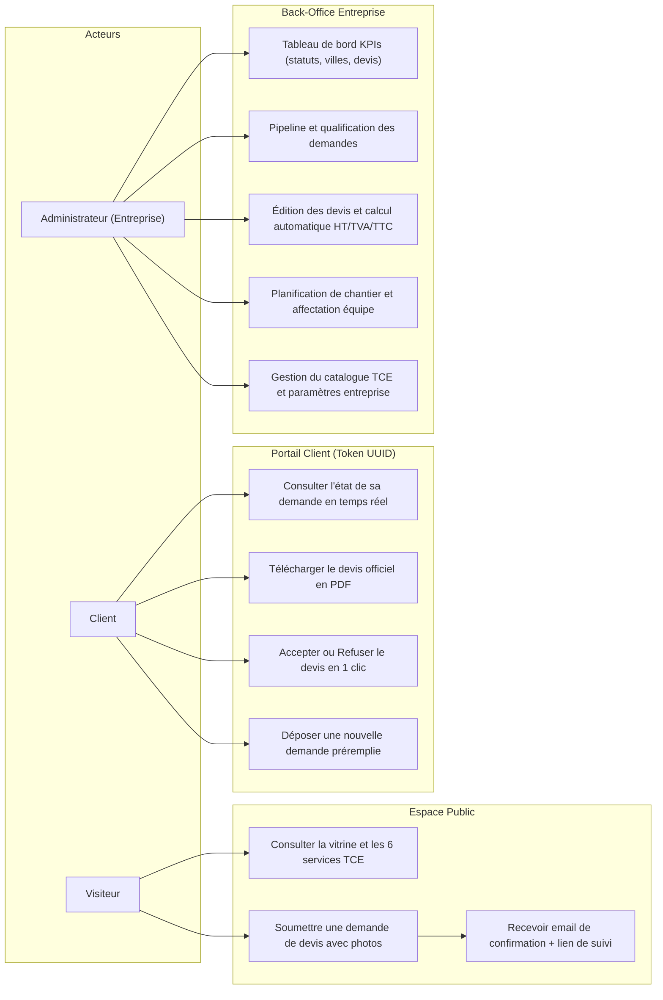
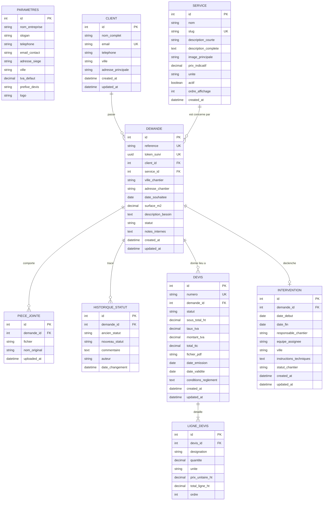
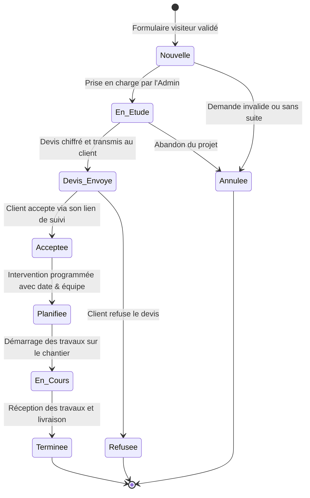
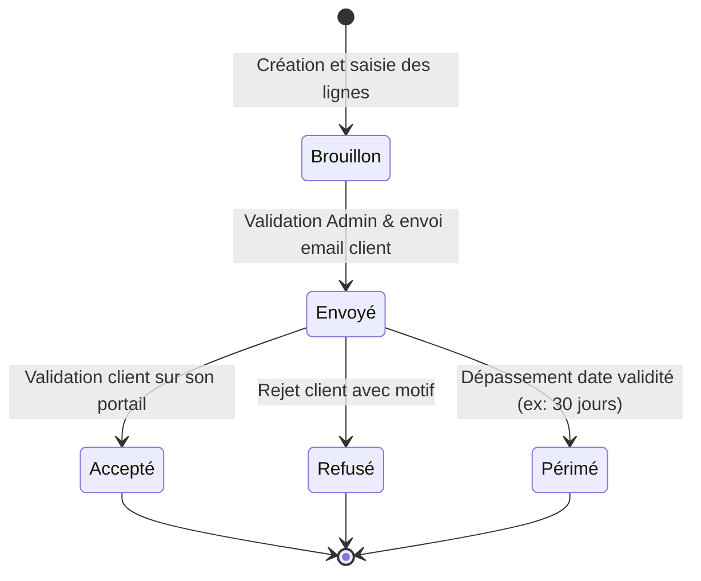

# ARCHITECTURE TECHNIQUE & MODÈLE DE DONNÉES — H.D.A GLOBAL

> **Projet** : Plateforme Web H.D.A GLOBAL (Construction TCE – Aménagement)  
> **Contexte** : Projet de Fin d'Études (Génie Logiciel) — Délai : 8 jours  
> **Stack** : Python 3.12, Django 5 (MVT, templates serveur), PostgreSQL 16, Docker Compose, ReportLab, Tailwind / Bootstrap 5  
> **Livrable** : `docs/ARCHITECTURE.md` (Étape B)

---

## 1. Principes Architecturaux & Organisation Modulaire

L'application respecte rigoureusement le modèle architectural canonique **MVT (Modèle - Vue - Template)** de Django. Conformément aux spécifications, il n'y a aucune Single Page Application (SPA) cliente : le rendu HTML est généré côté serveur, garantissant un référencement (SEO) optimal pour le BTP, un temps de chargement ultra-rapide sur mobile, et une robustesse accrue.

Le projet est découpé en 6 applications Django spécialisées, indépendantes et hautement cohésives :

```
hda_project/
├── core/           # Pages institutionnelles (Accueil, Contact, À propos), Singleton Paramètres, Context Processors
├── services/       # Catalogue des 6 prestations TCE, gestion des réalisations et tarifs indicatifs
├── clients/        # Gestion des clients, déduplication par email, historique des demandes
├── demandes/       # Formulaire public de demande de devis, anti-spam, upload photos, token de suivi UUID4
├── devis/          # Chiffrage (lignes, sous-total HT, TVA 20%, TTC), moteur pricing.py, génération PDF ReportLab
└── interventions/  # Gestion des chantiers (FSM), planification, affectation d'équipes et chefs de chantier
```

---

## 2. Diagramme des Cas d'Utilisation (Rôles & Interactions)



---

## 3. Modèle de Données Conceptuel & Diagramme Entité-Relation (ER)



---

## 4. Diagrammes d'États & Cycles de Vie

### 4.1 Cycle de Vie d'une Demande de Devis


### 4.2 Cycle de Vie d'un Devis


---

## 5. Plan de Routage des URLs & Vues (Django)

| URL Pattern | Vue (App) | Rôle & Description |
| :--- | :--- | :--- |
| **Vitrine Publique** | | |
| `/` | `core:home` | Accueil : présentation entreprise, 6 services TCE, réalisations, CTA devis |
| `/services/` | `services:list` | Catalogue complet des services avec filtres et prix indicatifs au m² |
| `/services/<slug:slug>/` | `services:detail` | Fiche détaillée d'un service (étapes, galerie, formulaire contextuel) |
| `/a-propos/` | `core:about` | Présentation H.D.A GLOBAL, histoire, valeurs, zones d'intervention |
| `/contact/` | `core:contact` | Coordonnées, adresses Casablanca/Mohammedia, carte, WhatsApp direct |
| **Tunnel Demande de Devis** | | |
| `/devis/demande/` | `demandes:create` | Formulaire de demande (avec upload photos, honeypot anti-spam) |
| `/devis/confirmation/<str:reference>/` | `demandes:confirmation` | Page post-soumission avec numéro de référence et récapitulatif |
| **Portail Client (Token UUID)** | | |
| `/suivi/<uuid:token>/` | `demandes:suivi` | Dashboard client sans mot de passe : statut, historique, devis |
| `/suivi/<uuid:token>/devis/<int:devis_id>/pdf/` | `devis:telecharger_pdf` | Téléchargement sécurisé du PDF officiel ReportLab |
| `/suivi/<uuid:token>/devis/<int:devis_id>/action/`| `devis:client_action` | Endpoint POST pour Accepter ou Refuser le devis |
| `/suivi/<uuid:token>/nouvelle-demande/` | `demandes:client_nouvelle` | Formulaire prérempli pour renouveler une demande |
| **Back-Office Entreprise** | | |
| `/admin/` | `admin:index` | Interface d'administration Django hautement personnalisée |
| `/admin/dashboard/` | `core:admin_dashboard` | Tableau de bord analytique (KPIs, graphiques d'activité, métriques) |
| `/admin/demandes/<int:pk>/` | `demandes:admin_detail` | Vue détaillée avec aperçu des photos du chantier et changement d'état |
| `/admin/devis/creer/<int:demande_id>/` | `devis:admin_create` | Chiffreur interactif de devis avec ajout dynamique de lignes |
| `/admin/devis/<int:pk>/envoyer/` | `devis:admin_send` | Déclenchement de l'envoi email avec PDF joint et lien magique |
| `/admin/interventions/planning/` | `interventions:planning`| Vue calendrier/liste des chantiers planifiés et équipes affectées |

---

## 6. Moteur de Calcul & Règles Métier Financières

Inspiré de l'algorithme déterministe extrait de `QuotePilot`, le calcul des devis est encapsulé dans `devis/services/pricing.py` :

1. **Règle d'arrondi monétaire** :
   Tous les montants sont manipulés via le type Python standard `Decimal` avec quantification à 2 décimales et arrondi `ROUND_HALF_UP`.
2. **Calcul unitaire de chaque ligne** :
   $$\text{Total Ligne HT} = \text{Quantité} \times \text{Prix Unitaire HT}$$
3. **Sous-Total Hors Taxes** :
   $$\text{Sous-Total HT} = \sum_{i=1}^{n} \text{Total Ligne HT}_i$$
4. **Montant de la TVA (20 % par défaut au Maroc)** :
   $$\text{Montant TVA} = \text{Sous-Total HT} \times \left(\frac{\text{Taux TVA}}{100}\right)$$
5. **Total Toutes Taxes Comprises (TTC)** :
   $$\text{Total TTC} = \text{Sous-Total HT} + \text{Montant TVA}$$

---

## 7. Moteur de Génération PDF (ReportLab)

Le générateur est implémenté dans `devis/services/pdf.py` selon les standards graphiques de H.D.A GLOBAL :
- **Format** : A4 vertical, marges de 1.5 cm.
- **En-tête** : Logo vectoriel / haute résolution de H.D.A GLOBAL, coordonnées complètes (Beni Yakhlef / Casablanca, téléphone, email, IF, ICE, RC).
- **Bloc Destinataire** : Nom du client, adresse du chantier, date d'émission, date limite de validité (30 jours).
- **Tableau des prestations** : Colonnes stylisées (N°, Désignation des travaux, Unité, Quantité, Prix unitaire HT en MAD, Total HT en MAD) avec alternance de couleurs de lignes (`#F8FAFC`).
- **Bloc Récapitulatif Financier** : Total HT, TVA 20 %, Total TTC en Dirhams marocains (MAD).
- **Pied de page légal** : Mentions de garantie décennale BTP, conditions de règlement et signature.

---

## 8. Conteneurisation & Environnement Docker

Le déploiement local et la démonstration sont orchestrés via Docker Compose :
- **Service `db`** : Image officielle `postgres:16-alpine` avec volume persistant `postgres_data` et variables d'environnement sécurisées.
- **Service `web`** : Image basée sur `python:3.12-slim`, installation des dépendances système (compilateur C, bibliothèques d'images pour ReportLab/Pillow), exécution automatique des migrations, collecte des fichiers statiques et lancement du serveur Gunicorn / Django dev server.
- **Fixtures automatiques** : Commande Django de peuplement (`python manage.py load_demo_data`) créant les 6 services TCE officiels, les paramètres d'entreprise, un compte administrateur et un jeu de demandes/devis de démonstration.

